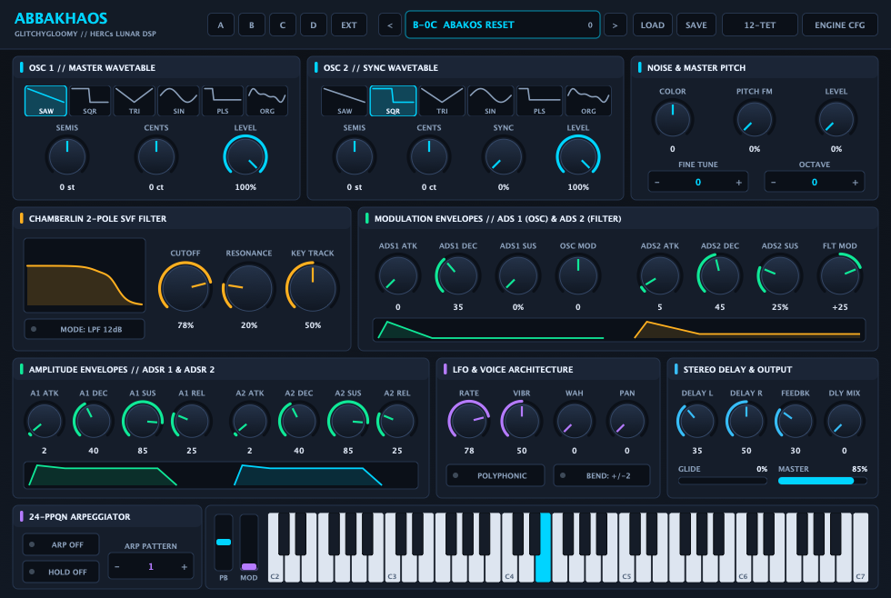

# AbbaKhaos

**Developer:** GlitchyGloomy  
**AI Agent / Implementation:** Agentically created with **Gemini 4 Argon**  
**Based On:** HERCs Abakos PRO & Lunar DSP Engine by Dr. Robert P. Wolf ([HERCs Music Systems](https://github.com/HERCsMusicSystems))  
**License:** [MIT License](./LICENSE)  
**Plugin IDs:** Manufacturer `GlGl` / Plugin `AbKh` (`com.glitchygloomy.abbakhaos`)  
**Supported Formats:**
- **macOS:** Audio Unit (`AU`) & `VST3` (Universal Binary `arm64` / `x86_64`)
- **Windows:** `VST3` (`x86_64`)
- **Linux:** `VST3` (`x86_64`)



---

## Overview

**AbbaKhaos** (by **GlitchyGloomy**) is an independent, open-source 64-bit cross-platform synthesizer based on the classic **HERCs Music Systems Abakos PRO** virtual analog, sync, ring-modulation, and microtonal synthesizer by **Dr. Robert P. Wolf**.

This entire package—including binary reverse-engineering analysis, clean-room C++17/JUCE 8 architecture, DSP porting, microtonal tuning integration, 100% procedural vector user interface design, testing harness, and cross-platform CI/CD notarization workflows—was **agentically created with Gemini 4 Argon**.

Built with **C++17** and **JUCE 8**, **AbbaKhaos** pairs Dr. Wolf's MIT-licensed **Lunar / Abakos** DSP synthesis engine with a newly designed, high-DPI, 100% procedural vector user interface, full DAW automation via `AudioProcessorValueTreeState`, all **512 factory presets** across Banks A–D, and **61 microtonal Scala (`.scl.tun`) tuning scales**.

> **Disclaimer & Non-Affiliation:** **AbbaKhaos** is an independent open-source fork developed by **GlitchyGloomy** and is not affiliated with or endorsed by HERCs Music Systems. It uses distinct plugin identifiers (`GlGl` / `AbKh`, `com.glitchygloomy.abbakhaos`) so it will never conflict with or impersonate original HERCs Music Systems plugins.

---

## Code Provenance & MIT License Compliance

This repository is released under the **[MIT License](./LICENSE)** and has been structured so that every line of code, preset bank, and tuning file has a clean, verifiable open-source or redistributable license:

1. **Core DSP Synthesis Algorithms — MIT License (`Copyright (c) 2014–2016 Robert P. Wolf`)**
   - While Dr. Robert P. Wolf's earlier 2003 repository ([`HERCsMusicSystems/HERCs`](https://github.com/HERCsMusicSystems/HERCs)) carried `ALL RIGHTS RESERVED` headers, he subsequently published his official Abakos synthesis engine port in **[`HERCsMusicSystems/lunar`](https://github.com/HERCsMusicSystems/lunar/tree/master/code)** under the standard **MIT License**:
     - [`lunar_integrated_abakos.cpp`](https://github.com/HERCsMusicSystems/lunar/blob/master/code/lunar_integrated_abakos.cpp) — Integrated Abakos voice architecture, dual oscillators, ring modulation, LFO routing, key/velocity maps, and stereo delay/chorus chain.
     - [`lunar_integrated_components.h`](https://github.com/HERCsMusicSystems/lunar/blob/master/code/lunar_integrated_components.h) & [`lunar_integrated_components.cpp`](https://github.com/HERCsMusicSystems/lunar/blob/master/code/lunar_integrated_components.cpp) — 2-pass oversampled Chamberlin 2-pole State-Variable Filter (`integrated_filter`), exponential envelopes (`integrated_adsr`, `integrated_eg`), pulse-symmetry LFO (`integrated_lfo`), 24-pattern arpeggiator (`integrated_arpeggiator`), and high-damped stereo delay (`integrated_delay`).
     - [`lunar.h`](https://github.com/HERCsMusicSystems/lunar/blob/master/code/lunar.h) & [`lunar.cpp`](https://github.com/HERCsMusicSystems/lunar/blob/master/code/lunar.cpp) — Core pitch/frequency tables, MinBLEP table generation, and the 24-bit Linear Congruential Noise Generator (`noise24b = (noise24b * 0x5599d1 + 1) & 0xffffff`).
   - All DSP code in [`src/dsp/`](./src/dsp/) is derived strictly from the MIT-licensed `HERCsMusicSystems/lunar` implementation and clean-room C++17/JUCE code, preserving Dr. Wolf's copyright and permission notice in compliance with the MIT License.

2. **64-Bit JUCE 8 Architecture & Modern Vector GUI — MIT License (`Copyright (c) 2026 GlitchyGloomy`)**
   - The original 2007 Abakos PRO Windows VST2 plugin used third-party bitmaps created by Vera Kinter (Artvera), which are **not** included in this repository.
   - Instead, [`src/PluginEditor.h`](./src/PluginEditor.h) and [`src/PluginEditor.cpp`](./src/PluginEditor.cpp) implement a **100% original procedural vector interface** authored by **GlitchyGloomy**, featuring real-time filter frequency-response visualization, interactive ADS/ADSR envelope graphs, vector pitch/mod wheels, and a 61-key MIDI keyboard. Zero bitmap files are used.

3. **512 Factory Presets (`HERCs Abakos PRO/a..d/*.txt`, `config.txt`, `setup.txt`)**
   - Included under the explicit redistribution grant in **Clause 3** of the original HERCs Music Systems software agreement:
     > *"3. The User may freely modify, copy, create and distribute all the text files (`*.txt`), which are part of the HERCs Software, except this user agreement."*
   - Note: The original 32-bit Windows binaries (`AbakosPRO.dll`, `config.exe`) and non-redistributable documentation are excluded from this repository via [`.gitignore`](./.gitignore).

4. **61 Microtonal Scala Tuning Files (`HERCs Abakos PRO/Tuning Files/*.scl.tun`)**
   - Standard microtonal scale definitions originating from the public-domain [Huygens-Fokker Foundation Scala Archive](https://www.huygens-fokker.org/scala/).

---

## Synthesizer Architecture

| Module | Description |
| :--- | :--- |
| **OSC 1 & OSC 2** | Dual band-limited wavetable oscillators (`Saw`, `Square`, `Triangle`, `Sine`, `25% Pulse`, `Harmonic Organ`) with coarse semitone (`-36..+36`), fine cent (`-100..+100`), hard/soft oscillator sync, and ring modulation (`OSC1 * OSC2`). |
| **Noise & FM** | Deterministic 24-bit LCG white noise generator (`state = (state * 0x5599D1 + 1) & 0xFFFFFF`) with spectral tilt color filter and oscillator pitch FM modulation. |
| **2-Pole SVF Filter** | 2-pass oversampled Chamberlin State-Variable Filter (`LPF` / `HPF` modes) with smooth cutoff, resonance, keyboard tracking, and cubic soft-clipping saturation. |
| **Modulation Envelopes** | **ADS 1** (bipolar pitch modulation for OSC 1/2) and **ADS 2** (bipolar filter cutoff modulation). |
| **Amplitude Envelopes** | Independent **ADSR 1** (OSC 1 VCA) and **ADSR 2** (OSC 2 + Noise VCA). |
| **LFO** | Wide-range LFO (`0.08 Hz – 20 Hz`) modulating Pitch (Vibrato), Filter Cutoff (Wah), and Stereo Panning, enhanced by Mod Wheel routing. |
| **Arpeggiator** | 24-PPQN host-transport-synced arpeggiator with **24 patterns** (`Up`, `Down`, `Up/Down`, `Up/Down Dup`, `Random Dup`, `Random` across 1–4 octaves) and `Hold` latch mode. |
| **Microtonal Engine** | Native Scala `.scl.tun` parser supporting non-12-TET, historical, and world tunings across all 128 MIDI notes. |
| **Stereo Delay & DC Blocker** | Independent Left/Right delay taps with warm one-pole low-pass feedback damping, followed by a configurable high-pass DC blocker (`5–30 Hz`) and up to **4x oversampling** / **64-voice polyphony**. |

---

## Building from Source

### Prerequisites
- **CMake** `>= 3.22`
- **C++17** compiler (Xcode / Clang on macOS, MSVC 2022 on Windows, GCC/Clang on Linux)
- Internet connection on first configure (CMake automatically fetches **JUCE 8.0.12** via `FetchContent`)

### macOS (AU, VST3, Standalone)
```bash
cmake -B build -DCMAKE_BUILD_TYPE=Release -DCMAKE_OSX_ARCHITECTURES="arm64;x86_64"
cmake --build build --config Release -j8
./build/AbbaKhaosTests
```

### Windows (VST3, Standalone)
```powershell
cmake -B build -DCMAKE_BUILD_TYPE=Release
cmake --build build --config Release --target AbbaKhaos_VST3 AbbaKhaosTests
.\build\Release\AbbaKhaosTests.exe
```

### Linux (VST3, Standalone)
```bash
sudo apt-get update
sudo apt-get install -y libasound2-dev libfreetype6-dev libfontconfig1-dev \
  libx11-dev libxcomposite-dev libxcursor-dev libxext-dev libxinerama-dev \
  libxrandr-dev libxrender-dev libgl1-mesa-dev
cmake -B build -DCMAKE_BUILD_TYPE=Release
cmake --build build --config Release --target AbbaKhaos_VST3 AbbaKhaosTests -j$(nproc)
./build/AbbaKhaosTests
```

---

## Automated GitHub Actions CI/CD

Every push, pull request, and version tag (`v*`) triggers [`.github/workflows/build.yml`](./.github/workflows/build.yml), which automatically builds, tests, bundles the factory presets & microtonal tunings inside each plugin's `Contents/Resources/HERCs Abakos PRO` folder, and packages:
- **`AbbaKhaos-macOS-AU-VST3.zip`** (`AbbaKhaos.component` + `AbbaKhaos.vst3`)
- **`AbbaKhaos-Windows-VST3.zip`** (`AbbaKhaos.vst3`)
- **`AbbaKhaos-Linux-VST3.zip`** (`AbbaKhaos.vst3`)
