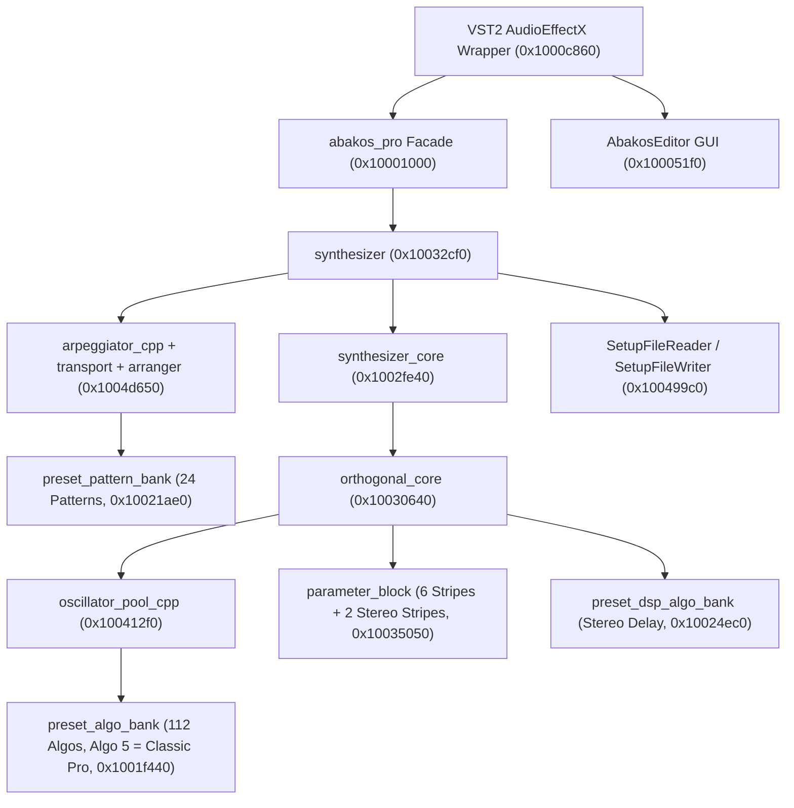

# HERCs Abakos PRO — Complete Reverse Engineering Technical Specification

## 1. Binary Identification & REA Evidence Catalog

Both original 32-bit Windows PE binaries in `HERCs Abakos PRO/` were disassembled and analyzed using **REA (`rea-agents` / `execute-rizin-command`)**.

| Binary | Size (Bytes) | Format / Architecture | Image Base | Compiler / PDB Path | Primary REA Evidence IDs |
|---|---:|---|---|---|---|
| `AbakosPRO.dll` | `2,473,984` | PE32 GUI DLL (`x86`, 32-bit) | `0x10000000` | MSVC 7.1 (`c:\dev\hrcs\abakos_pro_vst\Release\abakos_pro_vst.pdb`) | `ev_418339545a7fc0e8b7c03448a9ed6284366a201d19b374da377d9732d6226bbe`, `ev_85e77a8ae4241276f52aa83b26c7e7c8b05843030ef8c28f50a36806f7db14ca` |
| `config.exe` | `73,728` | PE32 GUI EXE (`x86`, 32-bit) | `0x00400000` | MSVC 7.1 | `ev_33bb9280dd0c9304f5ea45bd85da5677ef7209466de4861bda3674808a507a4a` |

### Complete REA Disassembly Evidence Ledger

1. **PE Headers, Section Tables, 1,447 Exported Symbols (83 C++ Classes), and Resources**:
   - `ev_418339545a7fc0e8b7c03448a9ed6284366a201d19b374da377d9732d6226bbe` (`iI; iS; iE; ii`)
   - `ev_85e77a8ae4241276f52aa83b26c7e7c8b05843030ef8c28f50a36806f7db14ca` (`iR; iz` — all 44 PE resources including `BITMAP 101..142`)
2. **VST 2.x Wrapper (`AudioEffectX`), `abakos_pro` Bridge (`0x10001000..0x1000ddd0`), and Artvera VSTGUI Editor**:
   - `ev_73a381cc9648d4ae072f670e4c6fa29ed13c7f74b46a183b72f62edc7426e0b2` (`0x10001000..0x100025a9`)
   - `ev_d1aab3eb3f56cc2087e0938c1a8f34aad6ace71932dd6ff73578a12fd4a5` (`0x100025aa..0x10003c32`)
   - `ev_9fe95dfb2be6465b100a08c35e8d7494a72c98d9379a009a882a63295c73a801` (`0x10003c33..0x100051ec`)
   - `ev_0a07394ad2947c17338e10921aa5367b3295f00a0b9c83bcb134bd37e618ba4d` (`0x100051f0..0x10006dd5`)
   - `ev_117c95167124520644489f7024e3e36926a2c9fa8ef582a474d282c195d582dc` (`0x10006dd8..0x100090fc`)
   - `ev_ae4d4d921ec43639a14cb5ca50778feba4e813a04411fe0aa0ba4f97d1eabbc9` (`0x10009100..0x1000c869`)
   - `ev_ad324df05c1ba86486cec3c4ead3204aa1528dc962ab6ab38bd58d5dfb8538b4` (`0x1000c86b..0x1000ddd0`)
3. **`preset_algo_bank` (112 Synthesis Algorithms), Algorithm 5 ("Classic Pro"), `preset_dsp_algo_bank` (Stereo Delay), and `preset_pattern_bank` (24 Arp Patterns)**:
   - `ev_b22cd5f58ba6a493b8ec235c15dd36f15362654c0e067fb10dcccf0361debc1e` (`0x10016040..0x10018a5b`)
   - `ev_125e6f0482d588043bef021b4abf85b7a34d2f9cc55cadf5bbc723686e41c340` (`0x10018a5c..0x1001db8b`)
   - `ev_eed6aa2a11fe4f175eb0e0f594f5afdd288d6e91ce4d7e0a27cf5eedee155f09` (`0x1001db8c..0x1001f40f`)
   - `ev_aa2aef8754e6354653baca204ec4d01329ac7ad9233ad0415ef89d3d7c11fd25` (`0x1001f410..0x10023ca4`)
   - `ev_282ec059d681e78c2d218d03d2de6985c8cb49aa58be4acd18c41ba0ed2b2b50` (`0x10023ca5..0x100284e5`)
   - `ev_81d1d65770dcb69d1606aeec8dc0fb443c639b2591659a1dbcf6395aa1d22bd4` (`0x10023ca0..0x10025a37`)
   - `ev_b692f36028381efca3cd36e42a7376eab2e0b0ece9a9e52271b357c28cca4e64` (`0x100284e6..0x10029a28`)
   - `ev_76bbe390dbd62e6c2f20437c1499ca4b376c2b77cd25f08559eca14355c982c7` (`0x10029a28..0x1002ac00`)
   - `ev_058eb03bf51e6c96cff04d5ca4b02b45560adb07bf21f71cd50cb7a10634dbd5` (`0x10045cd0..0x100469fc`)
   - `ev_8f57c1dac5e42268208071fa2dca4e15833a36f83a9247cf84b379a699d7ee5f` (All 112 `algo_pointer` vtables at `0x10079e88..0x1007ac48`)
4. **Core Engine (`synthesizer`, `synthesizer_core`, `orthogonal_core`), `oscillator_pool_cpp`, `parameter_block`, `arpeggiator_cpp`, `SetupFileReader`/`Writer`, and `config.exe`**:
   - `ev_e78e02570d6f30dd305ec294eece653f02ccc403befce9897530002ec50e6fe7` (`0x1002c0d0..0x100323e4`)
   - `ev_d8c7bb5ca524d3ce4bcd9f5ff5c1f6e37145242aa5622f3b5de445b69907a727` (`0x100323e5..0x10037be1`)
   - `ev_9b2b63aef4b91904ae2b00fdf9c7395291743d24b189653094c28c267d12665c` (`0x10037be0..0x1003b8be`)
   - `ev_56ba28c00206a9950e32c794018799fe7c5c8a8410187fde4d8cab0415e0eaae` (`0x1003b8c0..0x10041200`)
   - `ev_a99a811824fae4b527b65e1cc76311c149cf02700b56e9904a198604fd1e7d1c` (`0x10041210..0x10044b64`)
   - `ev_c92952948f9b6de997bde355156a24a4c22a3ce363a2d0d6936c868b73586ef3` (`0x10044b65..0x10045ccf`)
   - `ev_1578801bb4f0427bfd009f7fd34e0d5712c6735ada747eaf77f71bc718d0815a` (`0x100499c0..0x1004e385`)
   - `ev_33bb9280dd0c9304f5ea45bd85da5677ef7209466de4861bda3674808a507a4a` (`config.exe` `0x00401000..0x00402750`)

---

## 2. High-Level Architecture & Class Hierarchy

`AbakosPRO.dll` is built on the **HERCs Modular/Orthogonal Synthesis Engine** (`synthesizer` -> `synthesizer_core` -> `orthogonal_core`) wrapped by the `abakos_pro` facade class (`0x10001000..0x10004df0`) which exposes a fixed-architecture subtractive/FM/sync synthesizer with 49 VST parameters while internally driving the full HERCs 6-stripe + 2-stereo-stripe engine.



### Core Engine Data Flow (`orthogonal_core::move` at `0x10030840`)

Every audio sample frame is generated in 16-bit/32-bit fixed-point integer arithmetic (`-16384..+16384` nominal per voice, scaled to floating-point by `abakos_pro` in `process` / `processReplacing` at `0x1000cd90..0x1000d070`):

1. **Transport & Arpeggiator Tick (`transport::move` at `0x1004d6f0`)**:
   - Maintains a Bresenham phase accumulator at `24` PPQN (`step_pos = 48 * bpm`, `step_neg2 = 48 * bpm - 120 * sample_rate`).
   - On each tick, `arranger::tick()` invokes the active `preset_pattern_bank` pattern (`0..23`), which calls `arpeggiator_cpp::play_note(index, octave_offset, gate_ticks)` (`0x1004dec0`).
2. **Envelope & LFO Updates (`orthogonal_core::move` at `0x10030840`)**:
   - Control-rate divider `horizontal_counter` (`0x100991c8`, initialized to `sample_rate / 1200`) decrements each sample; when it reaches `0`, all active voices advance their ADSR/ADS envelope segments (`adsr_move`) and LFO accumulators (`lfo_move`), and recompute pitch/filter/pan modulation targets.
   - Smooth per-sample linear interpolation (`smoothed_value += step`) prevents zipper noise on amplitude, cutoff, and pan.
3. **Voice Synthesis (`algo_pointer::code` via `oscillator_pool_cpp`)**:
   - Each active voice executes `algo_pointer::code(voice_ptr)` (`[edx + 0x04]`).
   - In Abakos PRO presets, `[algo 0 "Classic Pro"]` selects **Algorithm 5 ("Classic Pro")** from `preset_algo_bank` (`0x100991e4` -> vtable `0x1007a498`), whose per-sample callback (`0x1001f440`) dispatches to one of 16 specialized inner loops (`0x1001f5b0..0x100219c0`) based on bitflags:
     - Bit 0 (`+0x28` of Stripe 0): `OSC2_SYNC` enabled (`> 0`)
     - Bit 1 (`+0x08` of Stripe 3): `NOISE_LEVEL` enabled (`> 0`)
     - Bit 2 (`+0x28` of Stripe 2): `NOISE_PITCH_MOD` enabled (`> 0`)
     - Bit 3 (`+0x28` of Stripe 4): `FILTER_TYPE` (`0` = LPF, `> 0` = HPF)
4. **Stereo Delay DSP (`preset_dsp_algo_bank`, `0x10024ec0..0x10025a37`)**:
   - Processes the summed stereo bus `[left, right]` through a dual circular delay line (`buffer_size = 4 * sample_rate`, mask/wrap at `buffer_size`), cross-feedback (`feedback` from Stereo Stripe 1), and wet/dry `mix` (from Stereo Stripe 0).
5. **DC-Offset Blocker & Output Scaling (`synthesizer_core::set_blocking_freq` at `0x1002fe40` & `abakos_pro::processReplacing` at `0x1000cf10`)**:
   - High-pass leaky integrator with shift `K` (`9..13`) derived from `dc_blocking_freq` (`1..30 Hz`) and `sample_rate`.
   - Scaled by `output_gain = 1.0f / (32768.0f * (1 << headroom))` and `global_level / 16384.0f`.

---

## 3. Complete 49 VST Parameters (`0x10002ba0..0x10004df0`)

`AbakosPRO.dll` registers **49 VST parameters** (`numParams = 0x31 = 49` at `0x1000c888`). Internally, `abakos_pro` maps these 49 parameters onto the 6 stripes and 2 stereo stripes of `parameter_block`:

| ID | VST Parameter Name | Internal `abakos_pro` Field | Engine Target (`parameter_block` / `synthesizer`) | Display Range & Unit |
|---:|---|---|---|---|
| 0 | `OSC1 SEMIS` | `+0x400` (`osc1_semis`) | Stripe 0 `freq` (`(semis * 128) + cents`) | `-24 .. +24` semitones |
| 1 | `OSC2 SEMIS` | `+0x404` (`osc2_semis`) | Stripe 1 `freq` (`(semis * 128) + cents`) | `-24 .. +24` semitones |
| 2 | `OSC1 CENTS` | `+0x408` (`osc1_cents`) | Stripe 0 `freq` fine offset (`* 1.28`) | `-50 .. +50` cents |
| 3 | `OSC2 CENTS` | `+0x40c` (`osc2_cents`) | Stripe 1 `freq` fine offset (`* 1.28`) | `-50 .. +50` cents |
| 4 | `OSC2 SYNC` | `+0x410` (`osc2_sync`) | Stripe 0 `index` (`0..16383`) | `0 .. 100` % |
| 5 | `OSC1 LEVEL` | `+0x414` (`osc1_level`) | Stripe 0 `amp` (`0..16383`) | `0 .. 100` % |
| 6 | `OSC2 LEVEL` | `+0x418` (`osc2_level`) | Stripe 1 `amp` (`0..16383`) | `0 .. 100` % |
| 7 | `ADS1 ATTACK` | `+0x41c` (`ads1_attack`) | Stripe 0 `freq_adsr.attack` (`0..16383`) | `0 .. 100` |
| 8 | `ADS1 DECAY` | `+0x420` (`ads1_decay`) | Stripe 0 `freq_adsr.decay` & `release` (`0..16383`) | `0 .. 100` |
| 9 | `ADS1 SUSTAIN` | `+0x424` (`ads1_sustain`) | Stripe 0 `freq_adsr.sustain` (`0..16383`) | `0 .. 100` % |
| 10 | `ADS1 MODULATION` | `+0x428` (`ads1_mod`) | Stripe 0 & 1 `freq_env` (`0..4095`) | `0 .. 100` % |
| 11 | `ADS2 ATTACK` | `+0x42c` (`ads2_attack`) | Stripe 4 `freq_adsr.attack` (`0..16383`) | `0 .. 100` |
| 12 | `ADS2 DECAY` | `+0x430` (`ads2_decay`) | Stripe 4 `freq_adsr.decay` & `release` (`0..16383`) | `0 .. 100` |
| 13 | `ADS2 SUSTAIN` | `+0x434` (`ads2_sustain`) | Stripe 4 `freq_adsr.sustain` (`0..16383`) | `0 .. 100` % |
| 14 | `ADS2 MODULATION` | `+0x438` (`ads2_mod`) | Stripe 4 `freq_env` (`0..16383`) | `0 .. 100` % |
| 15 | `ADSR1 ATTACK` | `+0x43c` (`adsr1_attack`) | Stripe 0 `amp_adsr.attack` (`0..16383`) | `0 .. 100` |
| 16 | `ADSR1 DECAY` | `+0x440` (`adsr1_decay`) | Stripe 0 `amp_adsr.decay` (`0..16383`) | `0 .. 100` |
| 17 | `ADSR1 SUSTAIN` | `+0x444` (`adsr1_sustain`) | Stripe 0 `amp_adsr.sustain` (`0..16383`) | `0 .. 100` % |
| 18 | `ADSR1 RELEASE` | `+0x448` (`adsr1_release`) | Stripe 0 `amp_adsr.release` (`0..16383`) | `0 .. 100` |
| 19 | `ADSR2 ATTACK` | `+0x44c` (`adsr2_attack`) | Stripe 1 `amp_adsr.attack` (`0..16383`) | `0 .. 100` |
| 20 | `ADSR2 DECAY` | `+0x450` (`adsr2_decay`) | Stripe 1 `amp_adsr.decay` (`0..16383`) | `0 .. 100` |
| 21 | `ADSR2 SUSTAIN` | `+0x454` (`adsr2_sustain`) | Stripe 1 `amp_adsr.sustain` (`0..16383`) | `0 .. 100` % |
| 22 | `ADSR2 RELEASE` | `+0x458` (`adsr2_release`) | Stripe 1 `amp_adsr.release` (`0..16383`) | `0 .. 100` |
| 23 | `NOISE COLOR` | `+0x45c` (`noise_color`) | Stripe 2 `freq` (`-4608..+4608`) | `0 .. 100` |
| 24 | `NOISE PITCH MOD` | `+0x460` (`noise_pitch_mod`) | Stripe 2 `index` (`0..16383`) | `0 .. 100` % |
| 25 | `NOISE LEVEL` | `+0x464` (`noise_level`) | Stripe 3 `amp` (`0..16383`) | `0 .. 100` % |
| 26 | `FILTER CUTOFF` | `+0x468` (`filter_cutoff`) | Stripe 4 `freq` (`-4608..+4608`) | `0 .. 100` |
| 27 | `FILTER RESONANCE` | `+0x46c` (`filter_reso`) | Stripe 5 `amp` (`0..16383`) | `0 .. 100` % |
| 28 | `FILTER PITCH MOD` | `+0x470` (`filter_pitch_mod`)| Stripe 4 `pitch.right_slope` (`0..16383`) | `0 .. 100` % |
| 29 | `DELAY 1` | `+0x474` (`delay_1`) | Stereo Stripe 0 `pan` (`0..16383`) | `0 .. 100` |
| 30 | `DELAY 2` | `+0x478` (`delay_2`) | Stereo Stripe 1 `pan` (`0..16383`) | `0 .. 100` |
| 31 | `DELAY FEEDBACK` | `+0x47c` (`delay_feedback`) | Stereo Stripe 1 `lfo_pan` (`0..16383`) | `0 .. 100` % |
| 32 | `DELAY MIX` | `+0x480` (`delay_mix`) | Stereo Stripe 0 `lfo_pan` (`0..16383`) | `0 .. 100` % |
| 33 | `LFO PITCH` | — | Stripe 0 `vibrato.right_slope` (`0..16383`) | `0 .. 100` % |
| 34 | `LFO FILTER` | — | Stripe 4 `vibrato.right_slope` (`0..16383`) | `0 .. 100` % |
| 35 | `LFO RATE` | — | Stripe 0 & 4 `lfo_speed` & Stereo 0 `lfo_speed` | `0 .. 100` |
| 36 | `LFO PAN` | — | Stereo Stripe 0 `lfo_pan_mod` (`0..16383`) | `0 .. 100` % |
| 37 | `LEVEL` | `+0x488` (`global_level`) | Master volume (`0..16384`) | `0 .. 100` % |
| 38 | `OSC1 WAVE` | — | Stripe 0 `wave` (`0..5`: Saw, Square, Tri, Sine, Pulse, Organ) | `1 .. 6` |
| 39 | `OSC2 WAVE` | — | Stripe 1 `wave` (`0..5`: Saw, Square, Tri, Sine, Pulse, Organ) | `1 .. 6` |
| 40 | `PORTAMENTO` | — | Stripe 0 `portamento_time` (`0..16383`, `on = time > 0`) | `0 .. 99` |
| 41 | `FILTER HPF/LPF` | — | Stripe 4 `index` (`0` = LPF, `16383` = HPF) | `LPF / HPF` |
| 42 | `TUNE` | — | Global `tune` (`-128..+127`, shifts `freq_logs` pointer) | `-99 .. +99` |
| 43 | `OCTAVE` | `+0x484` (`octave`) | Global `pitch` (`-3..+3` * `1536`, i.e. `12 * 128` per octave) | `-3 .. +3` |
| 44 | `PITCH BEND` | — | Stripe 0 `pitch.left_slope` & `right_slope` (`256` = 2st, `1536` = 12st)| `2 / 12` semitones |
| 45 | `MODE` | — | `poly` (`0` = Polyphonic, `1` = Monophonic) | `POLY / MONO` |
| 46 | `ARP ON/OFF` | — | `arpeggiator_cpp::set_arp_on(bool)` | `OFF / ON` |
| 47 | `ARP PATTERN` | — | `arranger::select_pattern(0..23)` | `01 .. 24` |
| 48 | `ARP HOLD` | — | `arpeggiator_cpp::set_hold(bool)` | `OFF / ON` |

---

## 4. Synthesis Engine Mathematical Specification

### 4.1 Wavetable & Frequency Table Initialization (`oscillator_pool_cpp`, `0x100412f0..0x100450b0`)

- **Log-Frequency Table (`freq_table` at `0x10099390`)**:
  - 128 log-units per semitone (`1536` units per octave).
  - MIDI note `N` (`0..127`) maps to base pitch `N * 128` (`0..16383`).
  - `freq_logs[pitch]` stores the 32-bit phase increment for `oscillator_pool_cpp`:
    $$\Delta \phi(\text{pitch}) = \text{round}\left(\frac{2^{32} \cdot 440.0 \cdot 2^{(\text{pitch} - 69 \times 128) / 1536.0}}{f_s}\right)$$
  - Global `tune` (`-128..+127`) shifts the `freq_logs` base pointer by `tune` entries (`oscillator_pool_cpp::notify_tune` at `0x10045090`), giving an exact $\pm 1$ semitone fine tune range.
- **6 Band-Limited Wavetables (`waves` at `0x100991b8`)**:
  - Built by additive Fourier synthesis in `oscillator_pool_cpp::constructor` (`0x100412f0..0x10044b64`) across octaves to prevent aliasing up to Nyquist, with 2048 samples per cycle (`phase >> 21` index):
    - **Wave 0 (Sawtooth)**: $\sum_{k=1}^{K} \frac{(-1)^{k+1}}{k} \sin(k \theta)$
    - **Wave 1 (Square)**: $\sum_{k=1,3,5\dots}^{K} \frac{1}{k} \sin(k \theta)$
    - **Wave 2 (Triangle)**: $\sum_{k=1,3,5\dots}^{K} \frac{(-1)^{(k-1)/2}}{k^2} \sin(k \theta)$
    - **Wave 3 (Sine)**: $\sin(\theta)$
    - **Wave 4 (Narrow Pulse / Harmonics)**: $\sum_{k=1}^{K} w_k \sin(k \theta)$
    - **Wave 5 (Organ / Even+Odd Harmonics)**: $\sin(\theta) + \frac{1}{2}\sin(2\theta) + \frac{1}{3}\sin(3\theta) + \frac{1}{4}\sin(4\theta) + \dots$

### 4.2 Algorithm 5: "Classic Pro" (`0x1001f440..0x10021ac0`)

Algorithm 5 (`"Classic Pro"`) is the core voice synthesis algorithm of Abakos PRO. Its `reset` method (`0x100219d0`) initializes per-voice state variables (`[ecx+0x74..0x98]`), and its `code` dispatcher (`0x1001f440`) selects one of 16 inner loops (`0x1001f5b0..0x100219c0`) based on the 4-bit mode index:

$$\text{mode} = (\text{sync\_on} \ll 0) \mid (\text{noise\_on} \ll 1) \mid (\text{noise\_fm\_on} \ll 2) \mid (\text{is\_hpf} \ll 3)$$

Inside each sample step (`0x1001f5b0`):
1. **White / Colored Noise & Noise Pitch Modulation**:
   - The 24-bit LCG (`0x10041240`) steps:
     $$\text{state}_{n+1} = (\text{state}_n \times \text{0x5599D1} + 1) \pmod{2^{24}}, \quad \text{noise} = (\text{state}_{n+1} - 2^{23}) \gg 10 \in [-8192, +8191]$$
   - A 1-pole state-variable color filter controlled by Stripe 2 frequency (`NOISE COLOR`, `[ecx+0x4c]`) filters the raw noise into colored noise (`[ecx+0x94]`, `[ecx+0x98]`).
   - When `NOISE PITCH MOD` (`[ecx+0x54]`) is active, the colored noise is scaled by `noise_pitch_mod` and added to the phase increments of OSC 1 and OSC 2.
2. **OSC 1 & OSC 2 with Hard/Soft Sync (`OSC2 SYNC`)**:
   - OSC 1 phase `[ecx+0x74]` advances by `osc1_freq_inc` (`[ecx+0x00]`).
   - OSC 2 phase `[ecx+0x78]` advances by `osc2_freq_inc` (`[ecx+0x24]`).
   - When `OSC2 SYNC` (`[ecx+0x08]`) is active and OSC 1 wraps around (`phase1 + inc1 < phase1`), OSC 2's phase is interpolated/pulled toward the reset phase by the sync amount (`0..16383`), smoothly morphing from free-running (`0`) to hard sync (`16383`).
   - Both oscillators are scaled by their respective envelope-modulated amplitudes (`OSC1 LEVEL * ADSR1`, `OSC2 LEVEL * ADSR2`) and summed with `NOISE LEVEL * colored_noise`.
3. **Resonant 2-Pole State-Variable Filter (Chamberlin SVF, LPF / HPF)**:
   - Driven by `FILTER CUTOFF` + `ADS2` envelope + `LFO FILTER` + `FILTER PITCH MOD` (`[ecx+0x58]`) and `FILTER RESONANCE` (`16384 - [ecx+0x60]` damping `q`):
     $$\text{hp} = x - \text{lp} - q \cdot \text{bp}$$
     $$\text{bp} \leftarrow \text{bp} + f \cdot \text{hp}$$
     $$\text{lp} \leftarrow \text{lp} + f \cdot \text{bp}$$
   - Outputs `lp` when `FILTER HPF/LPF == 0` (LPF) or `hp` when `FILTER HPF/LPF > 0` (HPF), clamped to `[-32760, +32760]` to model internal saturation (`0x1001f7bd..0x1001f7db`).
4. **Stereo Panning**:
   - Stereo Stripe 0 pan (`pan + lfo_pan`) splits the mono voice output into `[left_bus, right_bus]`.

### 4.3 All 112 HERCs Synthesis Algorithms (`preset_algo_bank`, `0x100991d0..0x1009938f`)

In addition to Algorithm 5 (`"Classic Pro"`), `preset_algo_bank` contains 112 algorithms (`0x10079e88..0x1007ac48`, documented in `30_all_algo_vtables.txt`, `ev_8f57c1dac5e42268208071fa2dca4e15833a36f83a9247cf84b379a699d7ee5f`), including:
- **Algorithms 0..3**: `"06 Stripes"` .. `"03 Stripes"` additive/FM combinators (`0x10016040..0x100167b0`)
- **Algorithm 4**: `"Classic"` (`0x1001de90`)
- **Algorithm 5**: `"Classic Pro"` (`0x1001f440`)
- **Algorithms 6..111**: 106 6-operator FM / phase-modulation routing topologies (`"[1>2>3>4>5>6]"`, `"[1>2>3]+[4>5>6]"`, etc., `0x10016820..0x1001db80`)

### 4.4 Stereo Delay (`preset_dsp_algo_bank`, `0x10024ec0..0x10025a37`)

`preset_dsp_algo_bank` implements 8 stereo delay algorithms (`"Stereo Delay"`, `"Cross Delay"`, etc.):
- Delay buffer length: `4 * sample_rate` stereo frames.
- Left delay time `D1 = (delay_1 * sample_rate) >> 14`, Right delay time `D2 = (delay_2 * sample_rate) >> 14`.
- Feedback `fb = delay_feedback` (`0..16383`), wet/dry mix `mix = delay_mix` (`0..16383`).

---

## 5. Arpeggiator & 24 Preset Patterns (`preset_pattern_bank`, `0x10021ae0..0x10024df0`)

`arpeggiator_cpp` (`0x1004da30..0x1004e385`) maintains a sorted array of held MIDI notes (`keys[128]`, `velocities[128]`, `held[128]`) and interacts with `preset_pattern_bank` (`0x10021ae0`, `ev_aa2aef8754e6354653baca204ec4d01329ac7ad9233ad0415ef89d3d7c11fd25`):
- **24 Built-in Patterns (`00..23`, displayed as `01..24`)**:
  - Patterns `0..7` (`"Up 1/16"`, `"Down 1/16"`, `"Up/Down 1/16"`, `"Random 1/16"`, `"Up 1/8"`, `"Down 1/8"`, `"Up/Down 1/8"`, `"Chord 1/8"`): step through held notes at 6-tick (1/16) or 12-tick (1/8) intervals across 1-3 octaves.
  - Patterns `8..23`: Rhythmic gate/octave/step sequences defined by the static pattern tables in `0x10021ae0..0x10024df0`.

---

## 6. Native File Formats (`SetupFileReader` / `SetupFileWriter` & `.tun` Microtonal Files)

### 6.1 S-Expression Preset & Config Format (`0x100499c0..0x1004a290`)
- **`config.txt`** (`config.exe` at `0x00401960`):
  ```text
  [polyphony 8]
  [blocking 12]
  [oversampling 1]
  [headroom 2]
  [multitimbral 0]
  ```
- **`setup.txt`**:
  - Maps MIDI channels and banks (`a`, `b`, `c`, `d`) to relative paths (`[program 0 "a/00.txt"] ...`).
- **Preset Files (`a/00.txt` .. `d/7F.txt`, 512 factory presets)**:
  - Stores `[category "..."]`, `[comment "..."]`, `[name "..."]`, `[algo 0 "Classic Pro"]`, `[dsp_algo 0 "Stereo Delay"]`, `[arp 0 "00"]`, `[poly 0]`, `[pitch 0]`, `[stereo 0 ...]`, `[stereo 1 ...]`, and `[stripe 0 ...]` through `[stripe 5 ...]`.

### 6.2 `.scl.tun` Microtonal Tuning Format (`synthesizer::load_scale` at `0x10032aa0`)
- Reads lines starting with `[Tuning]` or `Note XX=YYYY` (or raw integer cents/log-pitch per MIDI note `0..127`) and populates the 128-entry `scale_table` (`[synthesizer + 0x0c + note * 4]`), replacing the default equal-temperament mapping `note * 128`.
